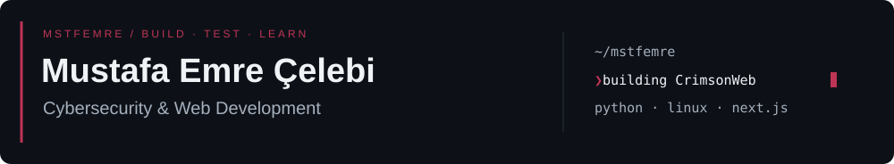
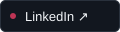
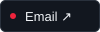
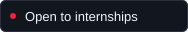
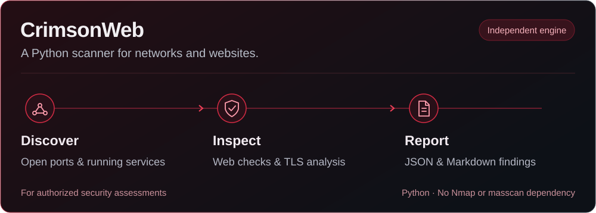
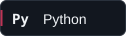
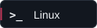
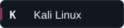
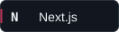
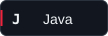

  
  
  

I'm a **Software Engineering student at Erciyes University** and **Head of Projects at EruSiber**. I build security tools in Python and websites with Next.js, with a growing focus on offensive security and web application security.

### My main project

**CrimsonWeb finds open ports, identifies running services and checks websites for security issues.** I built its scanning engine in Python, independently of Nmap and masscan, to bring discovery, security checks and reporting into one tool.

[Source code](https://github.com/mstfemre/CrimsonWeb) &nbsp; / &nbsp; [User guide](https://github.com/mstfemre/CrimsonWeb/blob/main/docs/USER_GUIDE.md) &nbsp; / &nbsp; [Local lab demo](demo/README.md)

### What I work on

- **Network reconnaissance** — port discovery, service fingerprinting and TLS analysis.
- **Web security** — HTTP security checks, exposure analysis and finding validation.
- **Python tooling** — native probes, controlled scanning and readable reports.

### Toolkit

  
  
  
  
  

### Also building for the web

I also build websites with Next.js: [AskMe Creative ↗](https://askmecreative.com) · [CRK Tourism ↗](https://crktourism.com)

### Contributions

<picture>
  <source media="(prefers-color-scheme: dark)" srcset="https://raw.githubusercontent.com/mstfemre/mstfemre/main/assets/contributions/snake-dark.svg" />
  <source media="(prefers-color-scheme: light)" srcset="https://raw.githubusercontent.com/mstfemre/mstfemre/main/assets/contributions/snake-light.svg" />
  
</picture>

Open to internships in offensive security, application security and security tooling.

