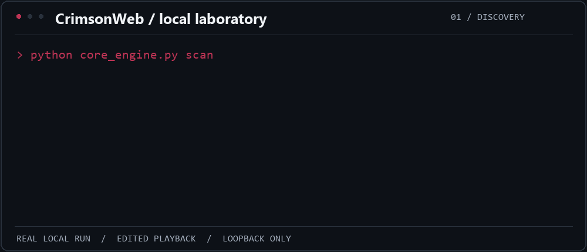
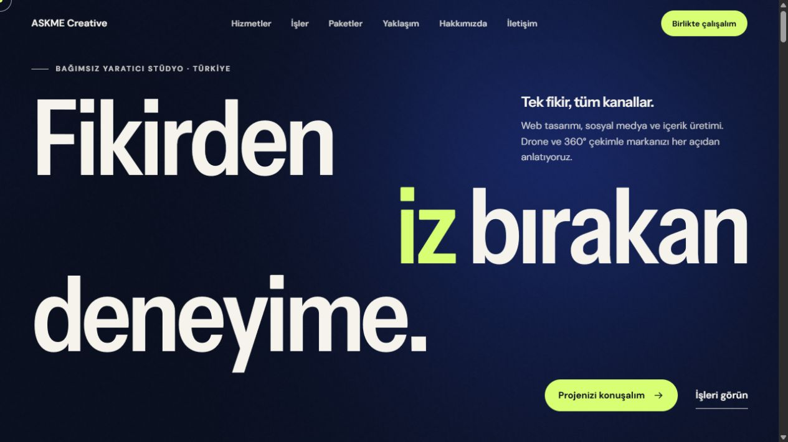
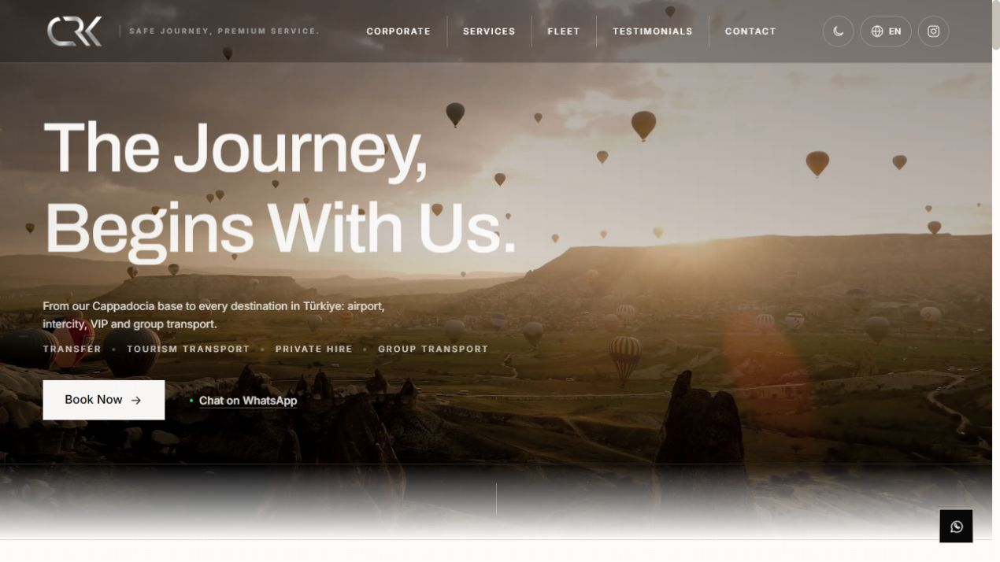

  
  
  

## CrimsonWeb

**An independent Python tool for authorized network and web security assessments.**
I build its native discovery engine, web checks and reporting without relying on Nmap or masscan.

Real loopback lab run, edited for readability. <a href="demo/README.md">Demo details &amp; actual output</a> · <a href="assets/crimsonweb-demo-still.png">Static version</a>

**TCP/UDP discovery** · **Service & TLS analysis** · **Web security checks** · **Structured reports**

[Explore the source →](https://github.com/mstfemre/CrimsonWeb) · [Read the guide →](https://github.com/mstfemre/CrimsonWeb/blob/main/docs/USER_GUIDE.md)

## Building for the web

<table>
  <tr>
    <td width="50%" valign="top">
      
      <h3>AskMe Creative</h3>
      
Creative studio website. Web development · Next.js

      <a href="https://askmecreative.com"><b>Live Demo ↗</b></a>
    </td>
    <td width="50%" valign="top">
      
      <h3>CRK Tourism</h3>
      
Tourism and transfer website. Web development · Next.js

      <a href="https://crktourism.com"><b>Live Demo ↗</b></a>
    </td>
  </tr>
</table>

## Tools I work with

  
  
  
  
  

Third-year **Software Engineering student at Erciyes University**, studying in English.
**Head of Projects** at the university’s Cybersecurity Student Club.
Interested in internships in **cybersecurity and web development**.

## Contributions in motion

<picture>
  <source media="(prefers-color-scheme: dark)" srcset="https://raw.githubusercontent.com/mstfemre/mstfemre/main/assets/contributions/snake-dark.svg" />
  <source media="(prefers-color-scheme: light)" srcset="https://raw.githubusercontent.com/mstfemre/mstfemre/main/assets/contributions/snake-light.svg" />
  
</picture>

My contribution history, animated. Updated daily.

