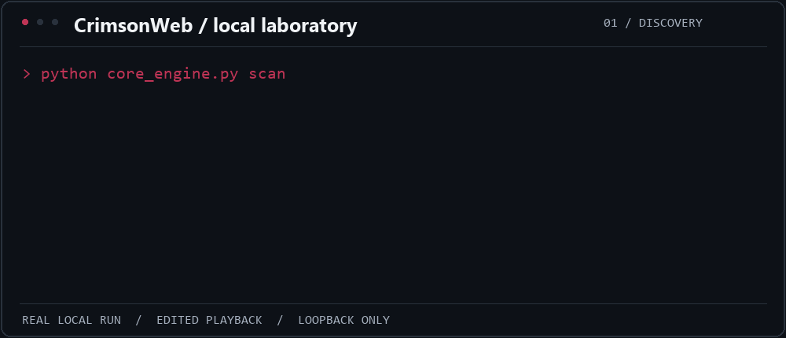

# CrimsonWeb local demo

The animation below is an edited replay of a successful local run of
[CrimsonWeb](https://github.com/mstfemre/CrimsonWeb/tree/429af3a).
It is not a live terminal or a performance benchmark. Command flags are abbreviated
on the animation; the full command is below. Report excerpts are reformatted for readability.



The disposable HTTP fixture listened only on `127.0.0.1:49899`. It served
`/`, `/robots.txt`, `/api` and `/health`, with 404 responses elsewhere. It deliberately
omitted four security headers. CVE lookups and passive recon were disabled; no external
targets were scanned. The server was shut down after the run.

```text
python core_engine.py scan -t 127.0.0.1 -p 49899 --no-cve --no-recon --timeout 1 --banner-timeout 2 --retry 0 --port-concurrency 1 --service-concurrency 1 --web-request-delay 0.01 --web-sensitive-delay 0.01 --web-max-global-rate 600 --web-max-retries 0 --decoy-rate 0 --output-dir reports --state-file demo-state.json --format json
```

- [Actual console output](console.txt), with local output-directory paths shortened.
- [Actual JSON report](report.json).
- [Static animation summary](../assets/crimsonweb-demo-still.png).

The scanner also classified `/robots.txt` as a sensitive-path hit and included three
MITRE mappings in its total of seven web findings. These are scanner labels, not proof
of exploitation; the animation highlights the concrete header observations instead.

## Reproduce the fixture

`record_local_demo.py` was the capture harness. It expects a `crimson-demo` checkout
beside the script and writes into a sibling `demo-recording` directory. Install the
scanner dependencies in a virtual environment and run the harness with that Python.
The operating system chooses a free loopback port for each run.
